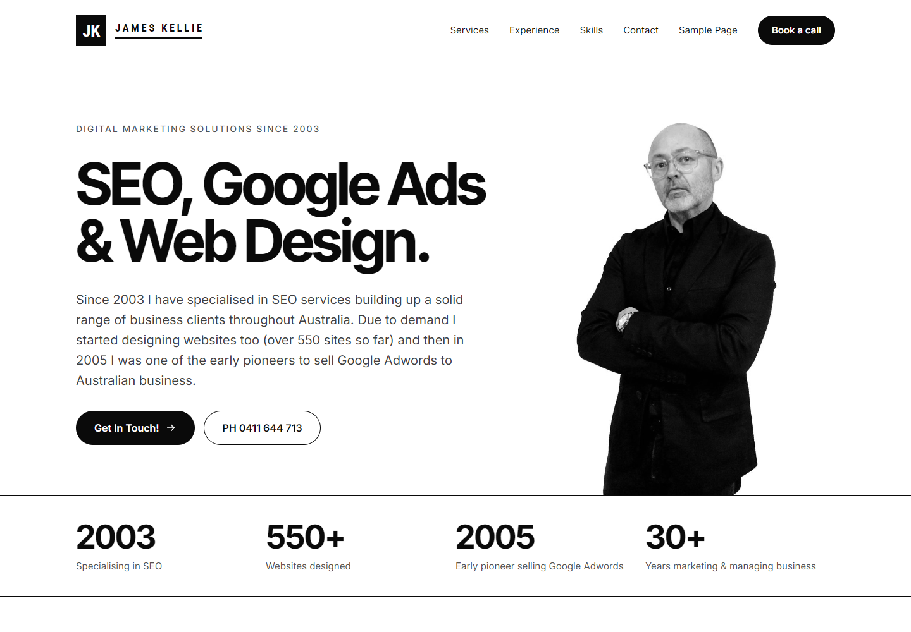
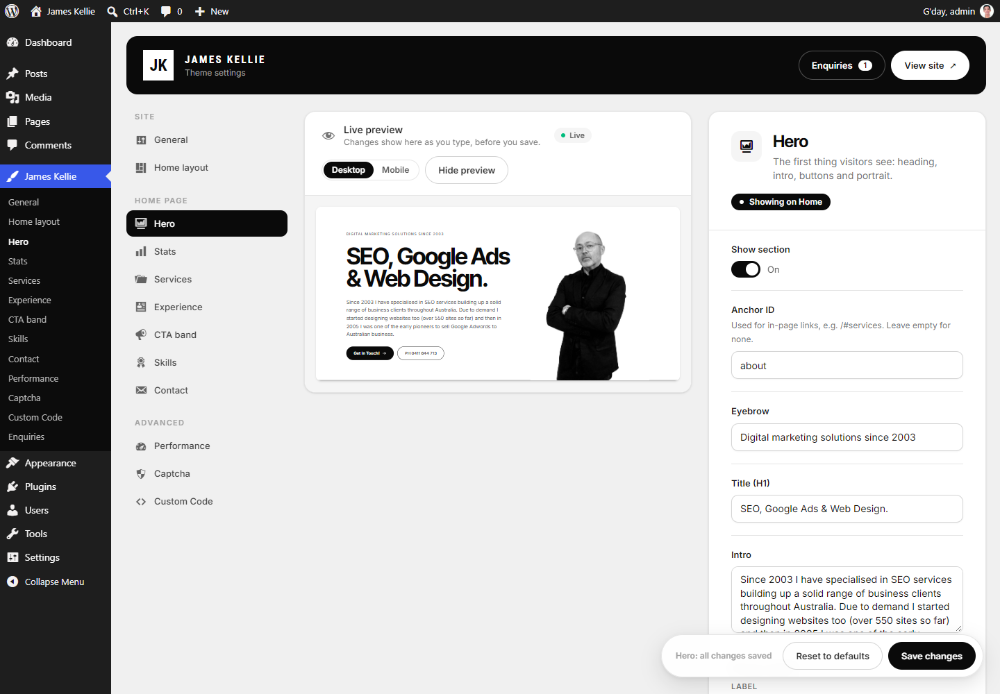
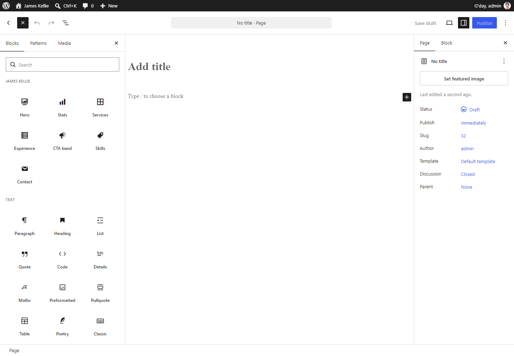
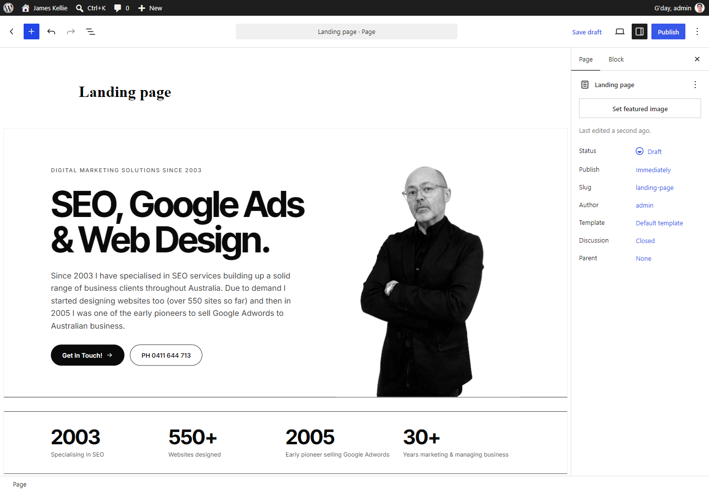
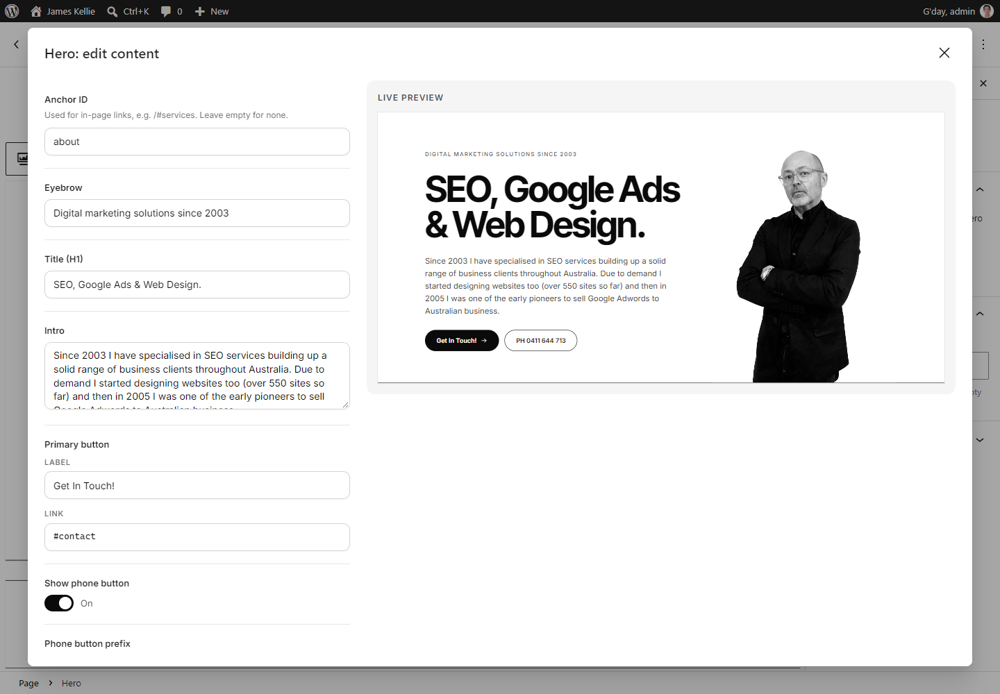

# James Kellie (React) theme

A WordPress theme for jameskellie.com.au in which the whole front end and the Theme Settings admin are React apps. It reads the same settings as the `jameskellie-theme` PHP theme, so you can switch themes without re-entering content.

## Screenshots

**Home page**



**Theme Settings** (James Kellie → Hero, with the live preview)



**James Kellie blocks** in the page editor: the inserter category, blocks on a page, and Edit content







## Setup

1. `composer install && npm install`
2. `npm run build` (or `npm run dev` while working; it runs Vite on port 5173 beside your local WordPress site). The block editor bundle isn't served by the dev server: run `npm run dev:blocks` alongside it to rebuild `dist/blocks/` on change.
3. Go to **Appearance → Themes** and activate **James Kellie (React)**.
4. Pretty permalinks must be `/%postname%/`.
5. Menus are stored per theme. Under **Appearance → Menus**, assign a menu to **Primary**, or leave it empty to get the automatic Services / Experience / Skills / Contact links.

## Editing content

- **James Kellie → General … Custom Code**: the React settings app. Changes save over the REST API, and the unsaved-changes dot shows anything not yet saved.
- **Pages → Book an Appointment**: the Book Appointment box on the page edit screen.
- **Export / Import** (on the General screen) uses the same JSON format as the PHP theme.
- **James Kellie blocks**: in the page editor, the inserter's **James Kellie** category has a block for each Home section: Hero, Stats, Services, Experience, CTA band, Skills and Contact. Each block keeps its own copy of the content. A new block starts with the section's current Theme Settings, and later Theme Settings changes don't affect it. Click **Edit content** (in the block toolbar or the sidebar) to edit the fields beside a live preview. Other blocks, such as paragraphs and images, can sit between them.
- **Page templates** (Page → Template): **Full Width** keeps the header and footer but drops the boxed title column. **Canvas** shows only the content, with no header, footer or back-to-top button, which suits landing pages built from James Kellie blocks.

## Versioning and releases

The version lives in three places, and the scripts keep them in step: the `style.css` header (the source of truth), `JK_VERSION` in `functions.php`, and `package.json`.

| Command | What it does |
|---|---|
| `npm run version:patch` | 2.0.0 → 2.0.1: fixes |
| `npm run version:minor` | 2.0.0 → 2.1.0: new features |
| `npm run version:major` | 2.0.0 → 3.0.0: breaking changes |
| `npm run bundle` | Builds the assets and writes `releases/jameskellie-vX.Y.Z.zip` |
| `npm run release` | Publishes that zip as GitHub release `vX.Y.Z` (needs `gh`, a clean tree and HEAD pushed) |

The bundle refuses to run while `npm run dev` is running (the `hot` file), or if the three versions disagree. The zip contains a `jameskellie/` folder with only what the live site needs: `inc/`, `config/`, `templates/`, `assets/`, `dist/`, `style.css` and the root PHP files. `src/`, `node_modules/`, `vendor/`, docs and scripts stay out. The `releases/` folder is gitignored.

A release:

```bash
npm run version:patch   # or minor / major
npm run bundle
git commit -am "chore: release vX.Y.Z"
git push
npm run release         # GitHub release with the zip attached
```

## Deploying

Upload `releases/jameskellie-vX.Y.Z.zip` under **Appearance → Themes → Add New → Upload Theme**, or upload the `jameskellie/` folder from the zip to `wp-content/themes/` over SFTP. The folder must be named `jameskellie`, because the Vite `base` in `vite.config.js` points there.

### Updates from GitHub

`style.css` declares `Update URI: https://github.com/slightgrey/jameskellie`, and `inc/Updater.php` answers WordPress's update check from the latest GitHub release (its `jameskellie-vX.Y.Z.zip` asset). After `npm run release`, live sites show the new version under **Dashboard → Updates** and **Appearance → Themes** (within 12 hours, or straight away with **Check again**), and update in one click or with auto-updates. The first version with the updater has to be uploaded by hand once. Updates are checked only while this theme is active.

Optional `wp-config.php` constants: `JK_UPDATER_DISABLED` (true turns checks off), `JK_UPDATER_REPO` (`owner/repo`), `JK_GITHUB_TOKEN` (for a higher API rate limit).

## Contact form email

Enquiries are always saved under **James Kellie → Enquiries**. The notification email goes to **Theme Settings → General → Enquiry email recipient(s)**, or to the site admin email if that is empty.

Most hosts block or spam-filter WordPress's default PHP `mail()`, so use SMTP: **James Kellie → Mail**, choose **SMTP** and enter the host, port, encryption, username and password of a mailbox on the site's domain (with SPF/DKIM set up). The From email and name are set there too, and **Send test email** (under the form) checks the saved settings. No plugin is needed.

To keep the password out of the database (it is otherwise included in settings exports), define it in `wp-config.php` instead. Constants override the Mail screen, and `JK_SMTP_HOST` forces SMTP on:

```php
define( 'JK_SMTP_HOST', 'mail.example.com' );
define( 'JK_SMTP_PORT', 587 );          // 465 with 'ssl'
define( 'JK_SMTP_SECURE', 'tls' );      // 'tls', 'ssl' or ''
define( 'JK_SMTP_USER', 'noreply@jameskellie.com.au' );
define( 'JK_SMTP_PASS', 'the-mailbox-password' );
// Optional: JK_MAIL_FROM, JK_MAIL_FROM_NAME
```

If sending fails, the enquiry shows "Not delivered" with the mail server's error.

## SEO note

Pages are rendered in the browser. The `<head>` (title, description, canonical, Open Graph, JSON-LD, GTM) is still printed by PHP on every URL, and Google renders JavaScript. A small `<noscript>` block covers visitors without JavaScript.

## Licence

Copyright (C) 2026 Vince. Licensed under GPL v2 or later, the same licence as WordPress. See [LICENSE](LICENSE). The bundled fonts (Inter, Inter Tight, Roboto Condensed) are under the SIL Open Font License 1.1.
